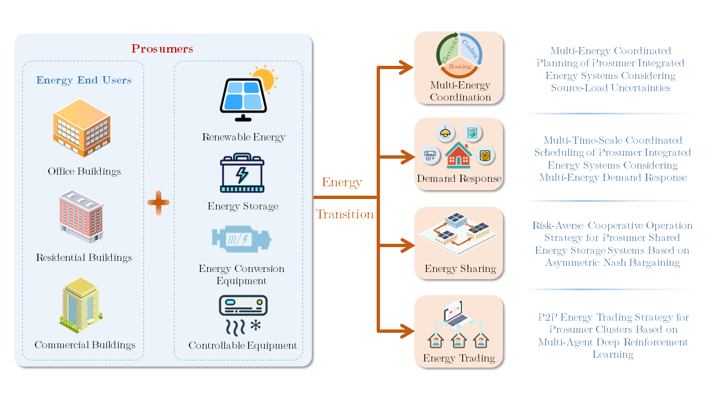








  

# About Me
I am a PhD candidate in Electrical Engineering at Wuhan University, China. Aiming to improve the **efficiency, flexibility, and coordination** of power systems through **intelligent decision-making**, my research focuses on **demand-side energy management**, including multi-energy coordination, demand response, energy sharing, and peer-to-peer energy trading.

# Research Overview

  

# News

- **Jun. 2026** - Our paper “<a class="news-paper-link" href="https://doi.org/10.13336/j.1003-6520.hve.20260199">Asymmetric Nash Bargaining-based Cooperative Operation Strategy for Shared Energy Storage Systems</a>” was published online ahead of print in **High Voltage Engineering**.

- **Feb. 2026** - Our paper “<a class="news-paper-link" href="https://doi.org/10.1016/j.renene.2026.125485">Optimal configuration and operation of multi-energy commercial buildings considering source-load uncertainties and battery degradation in different climatic conditions</a>” has been accepted for publication in **Renewable Energy**.

- **Jun. 2023** - Received the <strong class="news-award">Best Paper Award</strong> at the IEEE International Conference on Predictive Control of Electrical Drives and Power Electronics (PRECEDE 2023).
{: .news-list tabindex="0" aria-labelledby="news"}

# Education
- 2021 - now, Ph.D., Wuhan University,  Electrical Engineering
- 2023 - 2024, Joint Ph.D., UniversitatPolitècnicade Catalunya (UPC),  Electrical Engineering
- 2017 - 2019, M.Sc., Huazhong University of Science and Technology,  Electrical Engineering
- 2012 - 2016, B.Sc., Huazhong University of Science and Technology,  Electrical Engineering and Automation

# Publications

  

    

      
    

  

  

[Optimal configuration and operation of multi-energy commercial buildings considering source-load uncertainties and battery degradation in different climatic conditions](https://doi.org/10.1016/j.renene.2026.125485)

**Ting Ding**, Jianwei Shao, Junhua Wang, Jose Matas, Yang Si, Josep M. Guerrero

*Renewable Energy*, 2026.

[**Paper**](https://doi.org/10.1016/j.renene.2026.125485)

  

  

    

      
    

  

  

[Asymmetric Nash Bargaining-based Cooperative Operation Strategy for Shared Energy Storage Systems](https://doi.org/10.13336/j.1003-6520.hve.20260199)

**Ting Ding**, Junhua Wang, Tian Yuan, Fan Zhang, Jianwei Shao

*High Voltage Engineering*, Early Access, pp. 1-17. (In Chinese; EI Compendex; CSEE T1)

[**Paper**](https://doi.org/10.13336/j.1003-6520.hve.20260199)

  

  

    

      
    

  

  

[Multi-Time Scale Energy Management Strategy based on MPC for 5G Base Stations Considering Backup Energy Storage and Air Conditioning](https://doi.org/10.1109/PRECEDE57319.2023.10174449)

**Ting Ding**, Junhua Wang, Jose Matas, Josep M. Guerrero, Ruixun Qiao, Chenlu Wang

*2023 IEEE International Conference on Predictive Control of Electrical Drives and Power Electronics (PRECEDE)*, 2023.

[**Paper**](https://doi.org/10.1109/PRECEDE57319.2023.10174449)

  

  

    

      
    

  

  

    <strong>Model predictive control of MMC-UPFC under unbalanced grid conditions</strong>
    

      Qiufan Yang, <strong>Ting Ding</strong>, Hengxin He, Xia Chen, Fengbo Tao,
      Zhicheng Zhou, Yang Xu, and Shu Chen
    

    

      <em>International Journal of Electrical Power &amp; Energy Systems</em>,
      vol. 117, Art. no. 105637, 2020.
    

    <a href="https://doi.org/10.1016/j.ijepes.2019.105637"
       target="_blank" rel="noopener noreferrer">
      <strong>Paper</strong>
    </a>
  

